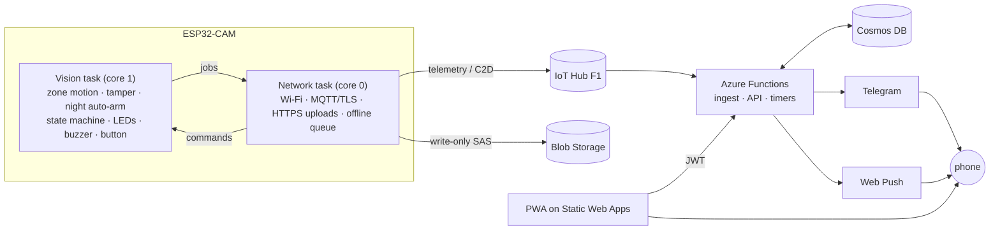

# ESP32-CAM Smart Home Security — Visual Intrusion Detection System

Project 7 (BITS, home security track). A flat-sized intrusion detector built from one AI-Thinker
ESP32-CAM plus a KY-038 sound sensor, a buzzer and a button, with an Azure backend, a
phone-friendly PWA and Telegram alerts. **No PIR**: motion comes from frame differencing inside
owner-drawn zones, sound from pulse counts against a learned baseline, and tamper from the image
itself (covered or moved). The spec is in [`docs/Project_7-_ESP32_CAM_Smart_Home_Security.pdf`](docs/Project_7-_ESP32_CAM_Smart_Home_Security.pdf).

> Status: backend, PWA, simulator and firmware are written, type-checked, linted, unit-tested and
> smoke-tested end to end **against the simulator in local mode**. The firmware compiles
> (1.05 MB, `min_spiffs` OTA partition) but has **not yet run on hardware**, and the Azure
> deployment has **not yet been exercised** (the subscription is not activated yet). The tables at
> the bottom are therefore empty on purpose. See *Honest gaps*.

## Problem

Notice an intruder from what the camera sees and what the sound sensor hears, capture evidence,
alert the owner on the phone within seconds, keep working when the internet is down, and let the
owner arm, disarm and configure everything from the phone, on a board with no display, no
microphone, no motion sensor, 4 MB PSRAM and very few free pins.

## Architecture



Full diagrams (layering, state machine, alert sequence, data model, security):
[`docs/architecture.md`](docs/architecture.md). Device JSON: [`docs/device-contract.md`](docs/device-contract.md).

### How it works

1. **Arm** from the app, Telegram, the button, a weekly schedule, or automatically after 5 dark
   minutes. 30 s exit countdown (red LED fast, buzzer ticks), then ARMED: auto-exposure settles on
   the empty room and is frozen, and a reference frame is stored.
2. **Watch** grayscale 160×120 frames; motion is scored only inside the owner's zones, and two
   consecutive frames over the threshold count. A near-black frame or a persistent mismatch with
   the reference is tamper. A whole-frame change (light switch) re-references instead of alarming.
3. **Listen** to KY-038 pulses per second against a rolling baseline that learns only from quiet windows.
4. **Capture** three SVGA JPEGs 300 ms apart (flash only after the trigger, only when dark), upload
   each through a 5-minute write-only SAS obtained with the device key, then publish the event.
5. **Alert**: Functions store the event, send Telegram (photo + Acknowledge/Disarm/Snapshot
   buttons) and Web Push, and repeat every 30 s until acknowledged (capped). Siren + strobe locally.
6. **Heartbeat** every 60 s with RSSI, uptime, brightness and the reset reason; the app shows
   OFFLINE after 3 minutes of silence. Offline, LEDs and buzzer keep working and events queue in PSRAM.

## Repository

| path | what |
|---|---|
| [`shared/`](shared) | TypeScript contract: message shapes, `DeviceConfig`, state machine, schedule, roles (tested) |
| [`api/`](api) | Azure Functions v4 (TypeScript): route table, domain logic, ports + adapters (Cosmos/memory, Blob/local, IoT Hub/local), timers, dev server, tests |
| [`app/`](app) | React + Vite + Tailwind PWA: status, arm/disarm, snapshot, zones, sliders, schedule, events, family, Telegram, push |
| [`simulator/`](simulator) | Node device simulator (local HTTP or real IoT Hub MQTT) with synthetic JPEGs |
| [`firmware/`](firmware) | PlatformIO/Arduino firmware for the ESP32-CAM ([firmware/README.md](firmware/README.md)) |
| [`docs/`](docs) | architecture, device contract, pin map, BOM, Azure + Telegram setup, test plan |
| [`scripts/`](scripts) | local smoke script, Telegram webhook helper |

## Quick start (no hardware, no Azure)

```sh
npm install
npm run build -w shared

# terminal 1: API in local mode (store persisted to api/.data, local blob folder)
cp api/.env.example api/.env         # then add VAPID keys: npx web-push generate-vapid-keys
npm run dev:api                      # http://localhost:7071/api

# terminal 2: PWA
npm run dev:app                      # http://localhost:5173  (First setup → setup code setup-1234)

# terminal 3: a fake camera. Keys: m motion · s sound · t/c tamper · d dark · b button · o offline · r brown-out
npm run sim -- --heartbeat 10
```

In the app: *Family → Devices* → register `cam-01` with upload key `dev-upload-key-123`, then arm,
press `m` in the simulator and watch the event with three photos arrive. Scripted version:
`./scripts/smoke-local.sh`. Quality gates: `npm run check` (type-check, lint, tests, builds).

Alerts reach the app without Telegram: a red ALARM banner with a beep and vibration appears on
every tab, and Web Push notifications arrive with the app closed once you enable them under
*Family → Push notifications* (needs the `VAPID_*` keys in `api/.env`).

**Real ESP32-CAM before Azure exists:** set `USE_LOCAL_DEV_SERVER 1` in `secrets.h` and the board
talks to this dev server over your Wi-Fi. Step by step: [docs/hardware-bringup.md](docs/hardware-bringup.md).

Telegram also works locally once `TELEGRAM_BOT_TOKEN` is set
([docs/setup-telegram.md](docs/setup-telegram.md), `npx web-push generate-vapid-keys`).

## Hardware

Bill of materials: [`docs/bill-of-materials.md`](docs/bill-of-materials.md). Pins and LED codes:
[`docs/pin-map.md`](docs/pin-map.md).

| GPIO | use |
|---|---|
| 33 | red LED (status, active low) |
| 4 | flash LED (night burst, alarm strobe) |
| 13 | buzzer |
| 14 | KY-038 digital out |
| 15 | override button to GND |
| 2, 12 | free (boot straps) |

Power: a real 5 V supply, short leads and a 470–1000 µF capacitor across 5 V/GND. The reset
reason in every heartbeat tells you if it browned out.

## Setup

1. Azure (IoT Hub F1, Storage, Cosmos free tier, Functions Consumption, Static Web Apps Free),
   with exact `az` commands: [`docs/setup-azure.md`](docs/setup-azure.md).
2. Telegram bot, webhook and chat linking: [`docs/setup-telegram.md`](docs/setup-telegram.md).
3. Firmware: `cp firmware/include/secrets.example.h firmware/include/secrets.h`, fill in, `pio run -t upload`.
4. App: register with the `SETUP_CODE`, claim the device, draw zones on a snapshot, invite family.

Secrets never enter git: `firmware/include/secrets.h`, `api/local.settings.json`, `.env*` are ignored;
`*.example` files are committed.

## Design decisions worth defending

- **Zones in normalised coordinates** so the phone draws on an SVGA snapshot and the chip scores a
  160×120 frame with the same rectangles.
- **Exposure locked while armed, flash only after a trigger**, otherwise the sensor's own
  adjustments are "motion".
- **One heavy network job at a time, on its own core**: uploads finish before the event is
  published; the vision loop never blocks on TLS.
- **No storage key on the device**: server-named blob, 5-minute write-only SAS, per-device upload key.
- **Device identity from the transport**, never from the JSON body.
- **Commands carry a timestamp**; the device drops anything older than 10 minutes, so an IoT Hub
  queue cannot replay yesterday's "disarm".
- **Ports and adapters** in the backend so the whole system runs on a laptop; cloud mode swaps three
  adapters.
- **Own JWT + invite codes** instead of Static Web Apps auth, because the linked-backend feature that
  forwards SWA identities is Standard tier (paid).
- **Camera as the light sensor**: the kit LDR needs ADC2, which is unusable while Wi-Fi is on.
- **microSD not used**: its 1-bit pins (2, 14, 15) are the sound sensor and the button; the RAM queue
  covers Wi-Fi outages instead.

## Measurements to fill in (hardware)

Numbers, not adjectives. Procedures are in [`docs/test-plan.md`](docs/test-plan.md) (H1–H17).

### Frames per second per camera mode

| mode | resolution / format | fps | notes |
|---|---|---|---|
| watch loop | QQVGA grayscale, exposure locked | | `stats:` log line |
| watch loop | QQVGA grayscale, auto-exposure | | |
| evidence burst | SVGA JPEG q=12 | | re-init ms, 3 shots total ms, average bytes |
| snapshot | SVGA JPEG | | round trip from tap to image in the app |

### Event-to-phone latency (5 trials each)

| path | median s | max s |
|---|---|---|
| motion → Telegram photo | | |
| motion → app event feed | | |
| motion → Web Push | | |
| sound → Telegram | | |

### 48-hour armed run in a real room

| metric | value |
|---|---|
| start / end | |
| true events (by type) | |
| false alarms (by type and cause) | |
| missed events (staged walk-throughs) | |
| resets (reset reasons from heartbeats) | |
| IoT Hub messages per day | |
| Wi-Fi outages survived / events queued and delivered | |

### Resume bullets (fill the numbers first)

- Built a camera-based intrusion system on the ESP32-CAM (zone motion, sound-spike and image-based
  tamper detection, night auto-arm from frame brightness) with Azure IoT Hub telemetry, Blob evidence
  storage and a React PWA for arm/disarm, zones and family roles; event-to-phone latency `<X>` s,
  `<N>` events and `<F>` false alarms over `<H>` h.
- Designed the firmware as two pinned FreeRTOS tasks (vision on core 1, TLS networking on core 0)
  with a locked-exposure motion loop at `<fps>` fps, 3-photo SAS uploads in `<T>` s, and an offline
  RAM queue; `<R>` brown-outs over `<H>` h after supply fixes.

## Honest gaps

Core items the spec requires and their state:

| requirement | state |
|---|---|
| zone motion, sound spike, image tamper on the ESP32-CAM | written, compiles, **not hardware-tested** |
| 3-photo burst to Blob via SAS | backend + simulator verified; firmware path compiles, untested on device |
| app: arm/disarm, schedule, zones, sensitivity, feed with photos, acknowledge | built and type-checked; exercised through the API and simulator, no browser automation yet |
| night auto-arm from camera brightness | implemented on device and simulator; threshold needs a real room |
| heartbeat + OFFLINE, LEDs/buzzer offline, queued events | backend tested; firmware offline queue compiles, untested |
| 48 h run, false-alarm and reset counts | **not done** (needs hardware) |
| Azure deployment | documented with exact commands; **not executed** (subscription not activated). Deploy bundle builds locally |

Stretch items **not built**: on-chip or cloud person/face check, I2S microphone, microSD queue,
video clips, Project 6 pairing, signed disarm commands, OTA (partition is OTA-capable, no updater
code), battery backup. Snapshot requested from Telegram shows up in the app, not back in the chat.
Web Push on iOS requires the installed PWA. Telegram group chats act with the linking user's role.
