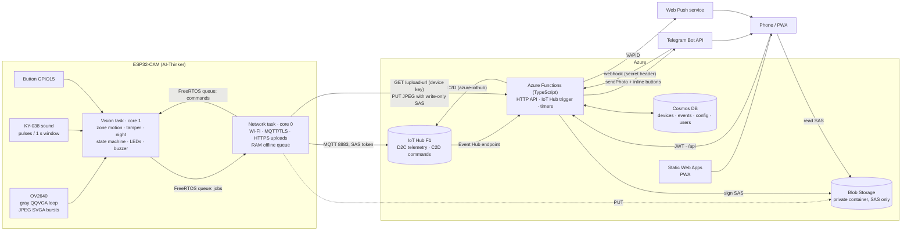
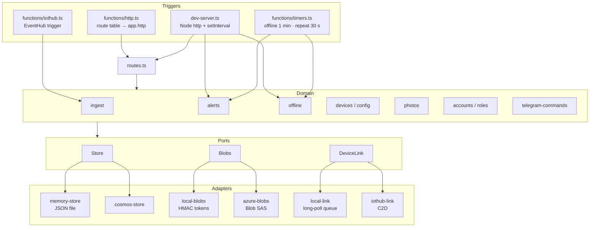
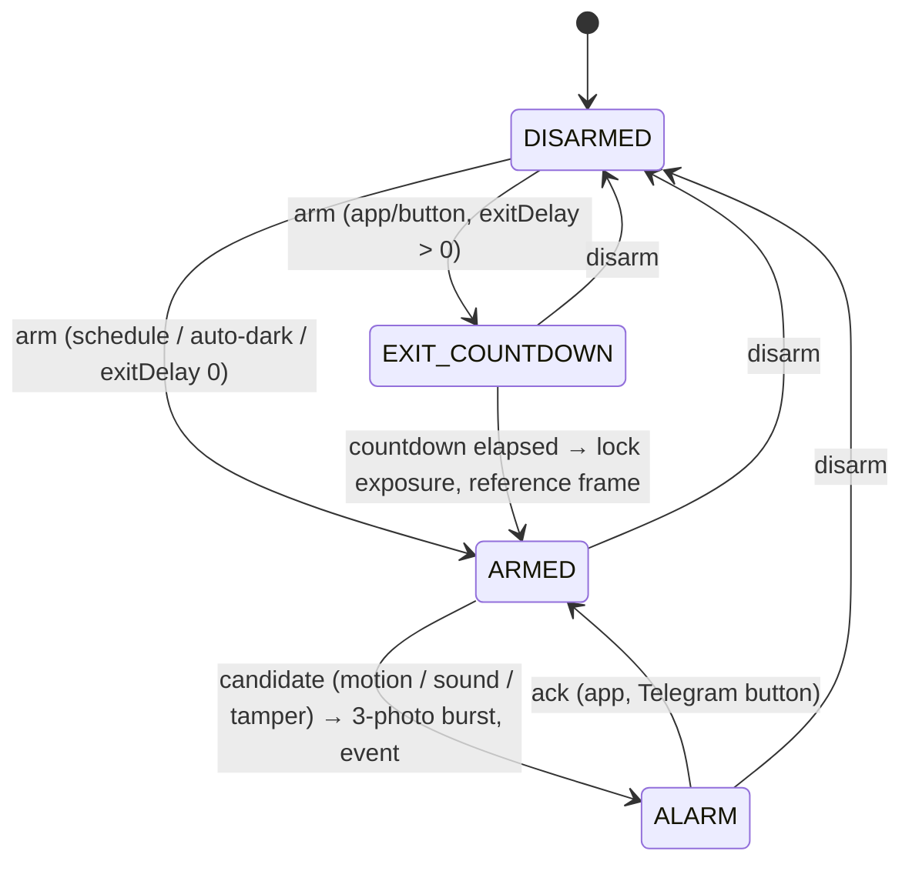
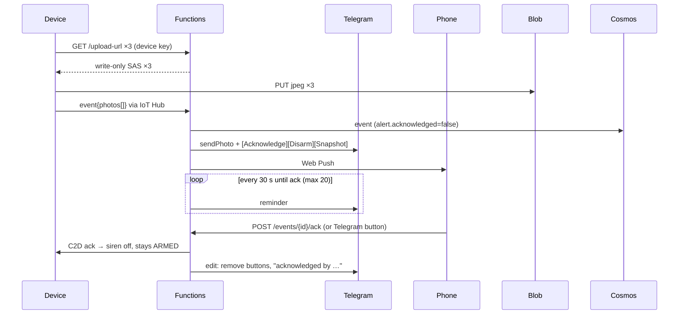

# Architecture

## System

## Backend layering (ports and adapters)

`services.ts` is the only place that chooses adapters (`APP_MODE=local|azure`). The domain and
routes never import an SDK, which is what makes every slice testable on a laptop without an Azure
account and lets the unit tests run in milliseconds against the memory store.

## Local, Supabase and Azure modes

Supabase mode uses the same HTTPS device routes as local mode, with Postgres, Storage and a
command table behind them; see [setup-supabase.md](setup-supabase.md).

### Local vs Azure

| concern | local (`npm run dev -w api`) | Azure |
|---|---|---|
| device → cloud | `POST /api/device/{id}/telemetry` (device key) | IoT Hub D2C → Event Hub trigger |
| cloud → device | `GET /api/device/{id}/commands` (device key) | IoT Hub C2D (`azure-iothub`) |
| photos | `PUT/GET /api/local/blob/{name}?perm=&exp=&sig=` (HMAC) | Blob SAS (`sp=cw` write, `sp=r` read) |
| data | `.data/store.json` | Cosmos DB |
| timers | `setInterval` | timer triggers |

The simulator speaks both: `--link local` (default) and `--link iothub`.

## Arming state machine

Implemented once in `shared/src/state-machine.ts` (used by the simulator, pinned by tests) and
mirrored in `firmware/src/control/AlarmStateMachine.cpp`.

## Alert lifecycle

## Data model (Cosmos)

| container | partition key | documents |
|---|---|---|
| `devices` | `/deviceId` | one per device: state, last heartbeat fields, household, upload-key hash |
| `events` | `/deviceId` | one per event with embedded `alert` state |
| `config` | `/deviceId` | current `DeviceConfig` (versioned) |
| `users` | `/householdId` | `type`: `user`, `household`, `invite`, `telegramLink`, `linkCode`, `pushSub` |

Cross-partition queries (user by email, Telegram chat by id, all devices for the offline timer) are
cheap at household scale and are isolated inside `cosmos-store.ts`.

## Security model

- **App users**: email + bcrypt password → HS256 JWT (7 d). The user document is re-read on every
  request so a role change or removal applies immediately. Roles: owner / member / viewer
  (`shared/src/roles.ts`), checked server-side on every route; household ownership is checked on
  every device, event and photo access.
- **Devices**: IoT Hub device key (SAS) for MQTT; a separate per-device upload key (sha256 stored)
  for the SAS-grant endpoint. The server names the blob, so a device writes only under its prefix.
- **Storage**: private container; app and Telegram only ever receive short-lived SAS URLs.
- **Telegram**: webhook authenticated by `X-Telegram-Bot-Api-Secret-Token`; only linked chats can
  act; linking requires a one-time code minted by an app user with `telegram.link` permission, and
  the linked user's *current* role gates every command and button.
- **Secrets**: none in the repo (`secrets.h`, `local.settings.json`, `.env` are gitignored).

## Why not Static Web Apps built-in auth?

IoT Hub and timer triggers cannot run in SWA-managed functions, and linking an external Function
App (which forwards the signed identity header) is a Standard-tier feature. SWA Free therefore hosts
only the PWA, and the API authenticates with its own JWT.
